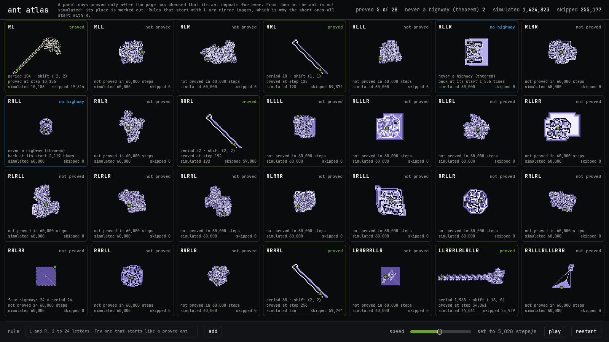
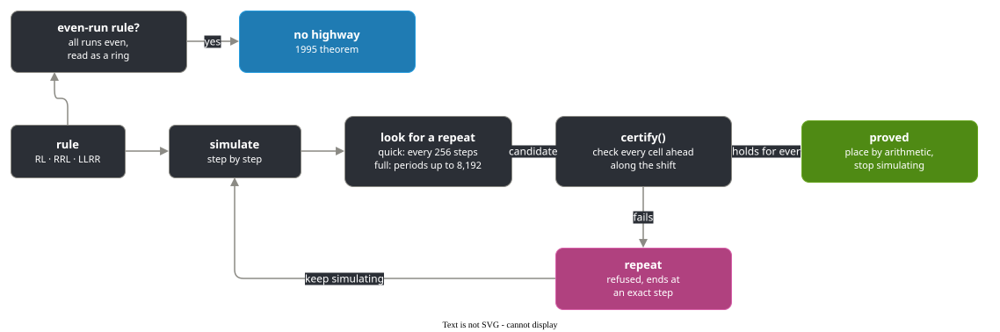
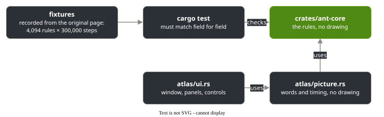
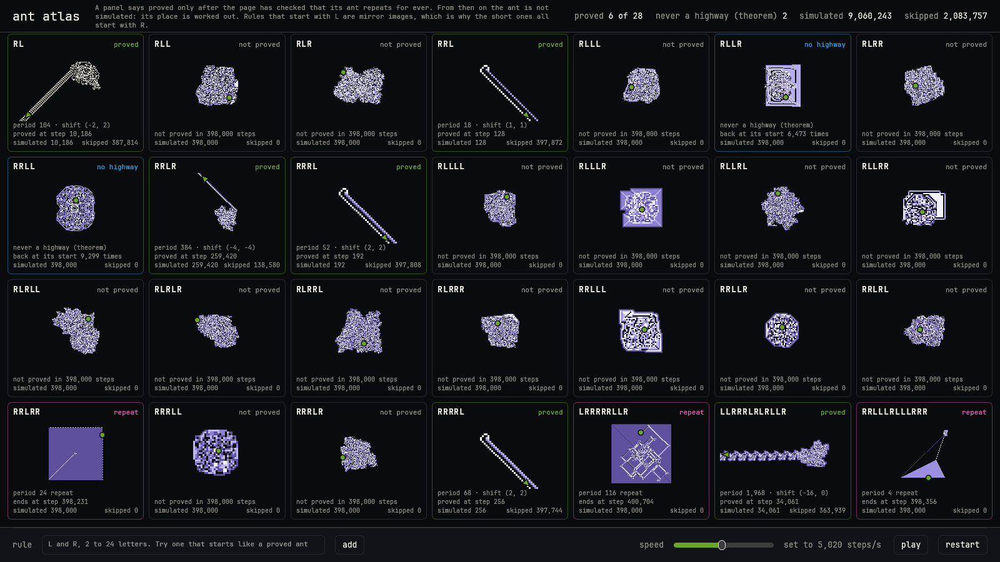
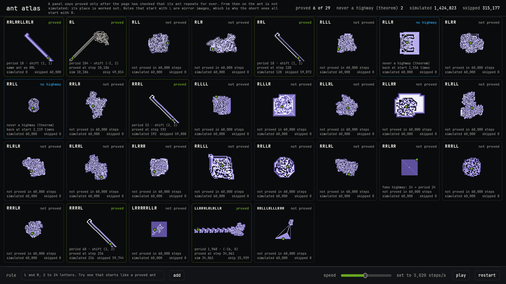

# Langton's ant atlas


**Which ants can be predicted without simulating every step?**
28 ant rules run side by side. The atlas proves which ones repeat for ever, then places them at any step by arithmetic.



## Contents

- [Run it](#run-it)
- [How it decides](#how-it-decides)
- [The same ant](#the-same-ant)
- [Code](#code)
- [Tests](#tests)

## Run it

```sh
cargo run --release -p atlas
```

| Control | Does |
|---|---|
| Rule box | Add a rule of 2 to 24 letters (`L`, `R`) as the first panel |
| Speed | Steps per second |
| Pause / restart | Stop the clock, or start every ant again at step 0 |
| Hover a panel | Details; for a proved ant, where it is at step 1,000,000,000,000 |

| Flag | Does |
|---|---|
| `--demo [N[,RULE]]` | Every ant at step N (default 60,000), paused |
| `--shot FILE.png` | With `--demo`: write one picture and exit, no window |

> [!NOTE]
> `index.html` is the original browser version. It still works: open it in a browser.

## How it decides



| Word | Means |
|---|---|
| 🟩 **proved** | `certify()` checked every cell ahead: the ant repeats for ever. |
| 🟪 **repeat** | The ant is repeating, but the check refused it. The panel shows the exact step it ends. |
| 🟦 **no highway** | Even-run rule. A 1995 theorem says the ant keeps coming back to its start. |
| **not proved in N steps** | Nothing is claimed. |

> [!IMPORTANT]
> Seeing a repeat proves nothing. `LRRRRRLLR` repeats the same 116 steps from step 396,128,
> then breaks at step 400,704. The atlas only says **proved** after the check.

<details>
<summary>Even-run rules</summary>

Read the rule as a ring: after the last letter comes the first. Cut it into runs of equal letters.
If every run has even length (`LLRR`, `RLLR`), the rule is even-run.
"Further travels with my ant" (1995) proves such an ant returns to its start cell for ever, so it never builds a highway.
The panel still simulates it and counts the returns.

</details>

## The same ant

A cell visited *v* times makes the ant read letter *v* of its rule, written again and again.
A proved highway never visits any cell more than a fixed number of times.

| Ant | Most visits to one cell | So the same ant as |
|---|---|---|
| `RRL` | 6 | any rule that starts `RRLRRL` |
| `RL` | 33 | any rule whose first 33 letters match `RLRL…` |

Type `RRLRRLLRLR`: its panel says **proved**, *same ant as RRL*, *simulated 0*.

## Code



| Path | What |
|---|---|
| `crates/ant-core` | The rules. No drawing, no dependencies. |
| `crates/atlas` | The window app. `picture.rs` decides, `ui.rs` draws. |
| `tools/js-reference.js` | Runs the rules of `index.html` to make the test fixtures. |

Diagrams are `.drawio.svg` files: open them in [draw.io](https://www.drawio.com) to edit.

## Tests

```sh
cargo test --release
```

- **Fixtures.** Every rule of 2 to 12 letters (4,094) at 300,000 steps matches the JavaScript field for field, down to every cell.
- **Traps.** Ants that repeat for a long time and then stop are never called proved.
- **Positions.** `position_at` equals a plain step-by-step ant at later steps.
- **Same ant.** Copies match a plain run of the copied rule.

<details>
<summary>More screenshots</summary>

**After 398,000 steps.** `LRRRRRLLR` says **repeat**, ends at step 400,704.



**A typed rule that is the same ant.** `RRLRRLLRLR` as the first panel: proved, same ant as RRL, simulated 0.



</details>
