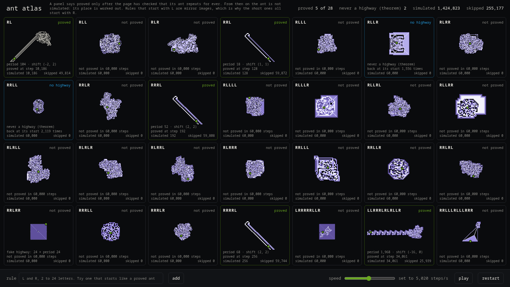
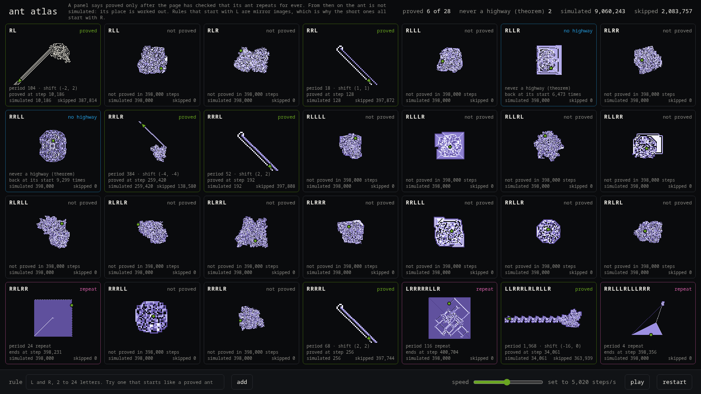
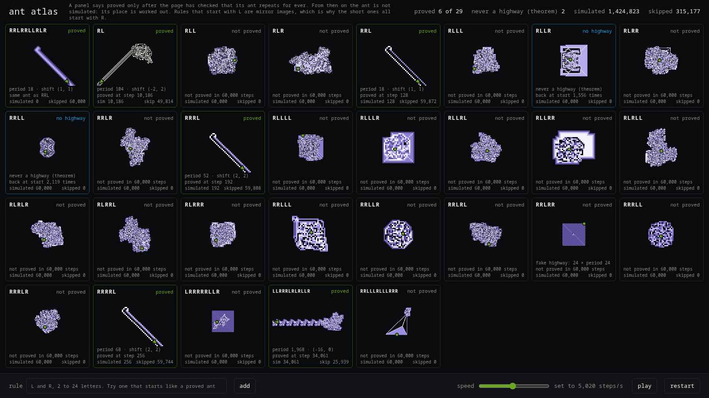

# Langton's ant atlas

One self-contained HTML file (`index.html`): download it and open it, nothing to install.

An ant walks on a grid of cells. A rule is a string of L and R, one letter per colour. Each step
the ant reads the colour under it, turns left or right as the rule says for that colour, gives
the cell its next colour and moves one cell forward. Which ants can be predicted without
simulating every step?

28 rules side by side, one ant per panel. Some ants end up doing the same steps again and
again, moved by a fixed shift each time. Seeing that happen a few times proves nothing, so the
page does not count repeats. It checks the cells ahead of the ant, and a panel says **proved**
only when that check holds. From then on the ant is not simulated: its place after any number
of steps is one line of arithmetic. Hover a proved panel to see where its ant is after
1,000,000,000,000 steps. Type a rule of your own in the box (2 to 24 letters).

A panel that is not proved says "not proved in N steps". That is all it claims. (Two panels say
**no highway** instead: see "Never a highway" below.)

Sometimes the check catches an ant in the middle of a repeat and refuses it: the cells ahead do
not fit. The panel then says **repeat** and gives the step at which the repeat ends. That step
is exact, so the panel keeps saying it until the ant gets there. Every 256 steps the page
looks for repeats with a period of up to 128 steps. It looks for longer periods less often.

A running page shows a repeat only if it will last at least half a second at the speed set.
A fast ant goes in and out of short repeats many times a second, and nobody could read the
word. A paused page shows every repeat it holds.

An unproved panel can also carry a line like "fake highway: 24 × period 24". This ant did the
same 24 steps 24 times in a row and then stopped. A detector that only counts repeats would have
called it a highway. The line names the longest refused repeat that the page has caught so far:
the one that covers the most steps. It is not the ant's record: the page looks every 256 steps,
and a short repeat can begin and end between two looks. The line shows only for a repeat of at
least 512 steps and 8 rounds, and not while the panel says **repeat**. Hover the panel to see at
which steps it happened.

**The same ant.** Type a rule that starts like a proved ant, for example `RRLRRLLRLR`. Its panel
says **proved** at once, with "same ant as RRL" and "simulated 0". This is not a guess. How an ant
turns on a cell depends only on how often it has stood there before: on the first visit it reads
the first letter of its rule, on the second visit the second letter, and so on (after the last
letter the rule starts again). The page counts the visits to every cell. From the proof it works
out the most visits any cell will ever get, for the whole endless run. For `RRL` that is 6. So
this ant never reads past six letters, `RRLRRL`, and every rule that starts with these six
letters makes the same moves for ever. The colours differ (ten colours here, three for `RRL`).
The path does not. `RRLRRR` has another sixth letter, so it gets an ordinary panel and is
simulated. Hover a proved panel to see its number: 33 for `RL`, 66 for `LLRRRLRLRLLR`.

**Never a highway.** Some rules get part of their verdict before the first step. Read a rule as a
ring: after its last letter comes its first. Cut the ring into runs of equal letters. If every run
has an even length, the rule is an even-run rule: `LLRR`, `LLRRRR`, and `RLLR`, where the two R meet
around the end. A theorem from 1995 ("Further travels with my ant") says that such an ant, started
on the blank grid, comes back to its start cell again and again for ever. An ant on a highway
leaves its start for ever. So an even-run ant never builds a highway. Every ant on this page starts
on the blank grid.

Two of the 28 start rules are even-run: `RLLR` and `RRLL`. Their panels say **no highway** from the
first frame, with the line "never a highway (theorem)". The page did not prove this. It only reads
the rule, and the theorem does the rest. The ant is still simulated: the theorem says what it will
never do, not where it will be. The line "back at its start N times" is counted by the page as the
ant walks. The top strip counts these panels. Type `LLRR` to get one at once. A repeat on such a
panel is shown on the second line while it runs. Of the 4,094 rules of 2 to 12 letters that start
with R, 114 are even-run, and in 300,000 steps the page proves none of them a highway.

A copy starts at the step at which its source was proved, so its marker is on the highway from
the start. After restart it is an ordinary ant again: at step 0 nothing is proved yet.
The tooltip of a copy says "RRL repeats from step 40": that number is `RRL`'s. The copy makes the
same turns, so they repeat from step 40 as well. Its own ten colours repeat only from step 56,
and that is the number its panel gives once it has proved itself after restart.

All three pictures are paused, so they show every repeat the page holds at that step. Pausing does
not make the page look any harder: the running page finds the same repeats at the same steps.

**After 60,000 steps.** 5 of the 28 ants are proved. Two say **no highway**: `RLLR` has been back at
its start 1,556 times and `RRLL` 2,119 times. The other 21 say "not proved in 60,000 steps".
One of them, `RRLRR`, carries a fake highway line: 24 rounds of 24 steps, and then it stopped.

**After 398,000 steps.** 6 are proved. Three panels say **repeat**, not proved. `LRRRRRLLR` is
doing the same 116 steps again and again. The check refuses it and gives the step at which that
ends: step 400,704. `RRLRR` is in a repeat of 24 steps that ends at step 398,231, and
`RRLLLRLLLRRR` in one of 4 steps that ends at step 398,356. No panel carries a fake highway line
here: the three ants with a long enough one are these three, and their line gives way to the repeat.
`RLLR` has now been back at its start 6,473 times and `RRLL` 9,299 times.

**A typed rule that is the same ant.** `RRLRRLLRLR` as the first panel, after 60,000 steps: proved,
"same ant as RRL", simulated 0. 6 of the 29 panels are proved. Its picture has the shape of the
`RRL` panel in other colours.

